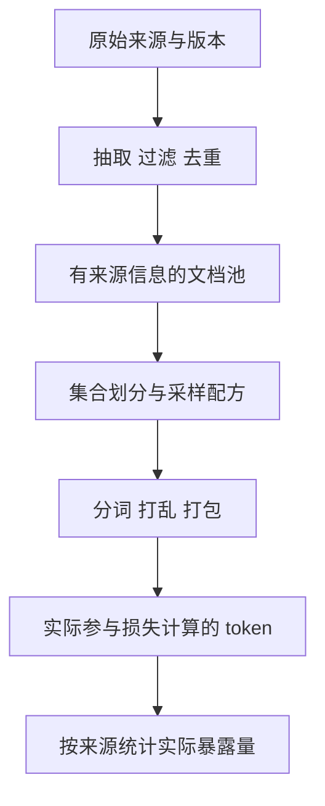

如果准备训练一个中文为主的语言模型，第一步似乎很简单：找一份足够大的中文数据，再混入一些英文和代码。然而，真正开始比较资料时，问题会接连出现。两个数据集可能来自同一批网页；“500 GB”和“150B tokens”没有直接的大小关系；某个以“教育”为名的数据集可能是网页正文，也可能已经变成问答指令；论文使用的完整语料与公开下载的部分也未必相同。

因此，选择预训练数据首先要回答的是：**模型将在什么采样规则下，反复看到哪些内容？** 数据集名称只是这件事的入口。

这是“大模型训练研究笔记”的第一卷，讨论文本预训练数据。预训练建立基础语言建模能力，后续的监督微调、偏好优化和强化学习则会改变训练目标及数据组织。先把数据来源和处理过程弄清楚，后面才能讨论一次后训练改动究竟增加了什么。

## 第一卷的阅读路线

| 篇目 | 主要问题 |
| --- | --- |
| 第一篇，本文 | 中英文开放语料有哪些构建路线，怎样选型？ |
| [第二篇：网页清洗](/posts/2026-10-15-llm-training-data-02-cleaning/) | 怎样从网页中保留可学习的正文？ |
| [第三篇：质量筛选](/posts/2026-10-15-llm-training-data-03-quality/) | “高质量”到底由什么标准定义？ |
| [第四篇：去重与污染](/posts/2026-10-15-llm-training-data-04-dedup/) | 怎样识别重复，并保持评测独立？ |
| [第五篇：混合与采样](/posts/2026-10-15-llm-training-data-05-mixture/) | 数据库存量怎样变成实际训练分布？ |
| [第六篇：可追溯构建](/posts/2026-10-15-llm-training-data-06-build/) | 怎样把这些决策组织成可重建的数据版本？ |

本文资料核对日期为 **2026 年 10 月 15 日**。规模数字分别保留原论文或数据卡的版本口径，不代表各项目当前所有分支的总量。这里的“主要”指能代表不同构建方法、有公开一手材料的项目，不是市场占有率排名，也不是所有开放数据的全集。

## 一、先区分来源、语料、配方和训练流

**原始来源**是 Common Crawl 的抓取记录、百科转储、代码仓库或获得授权的文档。它们决定可以接触到什么内容，但通常不能直接进入模型。Common Crawl 提供 WARC、WAT、WET 等文件：分别承载抓取内容、派生元数据和提取文本。它本身不是一份已经完成全部清洗的语言模型训练集。[Common Crawl 使用说明](https://commoncrawl.org/get-started)

**处理后的语料**是对来源执行抽取、筛选、去重等操作后的结果。FineWeb、CCI3.0-HQ 属于这一层。两个团队即使使用相同来源，也可能因抽取器、阈值和保留策略不同而得到不同训练分布。

**训练配方**规定各来源的比例、训练阶段和重复次数。一个拥有十亿 token 的语料池，可以被只采样一次，也可以循环多次；少量数据通过上采样可能占据训练的重要部分。

**实际训练流**是经分词、打乱、切分和打包之后送进模型的序列。截断、丢弃尾块、数据加载器提前停止和多进程重复读取，都可能使实际比例偏离配方。

调研时把这四层混为一谈，就会出现“下载了多少就是训练了多少”“论文用了多少就是公开了多少”的误读。

## 二、英文语料的几条代表路线

### 规则清洗与网页语料

[C4](https://huggingface.co/datasets/allenai/c4)是理解规则清洗的经典入口。阅读时要写清配置：英文 C4、未过滤配置和多语言 mC4 不能当作同一个实验对象。它适合用来追问一条看起来合理的规则究竟删除了什么，而不宜把“clean”理解成已经解决所有质量问题。

[RefinedWeb](https://huggingface.co/datasets/tiiuae/falcon-refinedweb/blob/main/README.md)把网页处理与去重作为核心路线。数据卡中的公开提取部分约为 **968M 网页、500B～650B tokens**，token 数随 tokenizer 改变；公开部分与论文构建的完整池需要分别记录。对选型而言，它提供了一个重要比较对象：大量网页经过系统处理后，能在什么条件下成为有效的预训练主体？

[FineWeb](https://huggingface.co/datasets/HuggingFaceFW/fineweb)的 2024 年首发规模约为 **15T tokens**，当前数据卡说明已超过 **18.5T tokens**。它的价值还在于公开构建实验：正文抽取、规则和去重都能逐步比较。2026 年阅读仓库时，应区分首发研究版本与后来增加的抓取批次，不能把新版本规模附到旧版实验结果上。

这些项目值得放在一起研究，但它们并非一条简单的“越新越好”排名。一个数据集的抽取器、目标语言、时间覆盖与评测设置都可能不同。比较具体方法时，最好回到同一研究中的对照实验。

### 多来源混合与可复现工具

[The Pile](https://arxiv.org/abs/2101.00027)以约 **800 GB、22 个组成部分**展示了多来源混合路线。它适合研究来源多样性和混合权重的历史设计。历史论文里的组成清单不等于今天每个子集都仍可从原入口获取；可访问性和各组成部分的条件要重新核对。

[Dolma](https://arxiv.org/abs/2402.00159)的原始研究描述约 **3T tokens 的英文语料**，来源覆盖网页、科学文献、代码、公共领域书籍、社交媒体与百科。它把语料说明与处理工具一起公开，适合研究“怎样让别人重建数据处理决策”。这里的原始 Dolma 与后续同名系列版本应分开比较。

[RedPajama-V2](https://github.com/togethercomputer/RedPajama-Data)则提供大规模网页及质量信号。官方表格对已标注并去重的 `head_middle` 部分估算为 **30.4T tokens，涵盖五种欧洲语言**；这一数字有特定切片口径，并非“全部原始内容”。它的用途之一，是让使用者根据保留的信号重新筛选，而不是接受唯一的质量阈值。

[SlimPajama](https://www.cerebras.ai/blog/slimpajama-a-627b-token-cleaned-and-deduplicated-version-of-redpajama)由 RedPajama 初代约 1.21T token 语料经过清洗、跨来源去重形成，发布规模为 **627B tokens**。它适合研究多来源之间的重复，不能与后来的 RedPajama-V2 混为同一条版本演进线。原始发布中对未来训练表现的预期，也应与已经报告的实验结果分开。

### 把数据质量放进受控训练实验

[DCLM](https://arxiv.org/html/2406.11794v1)同时包含实验框架、原始池和基线语料。“使用 DCLM”至少要说明使用的是哪一层。其原始论文以固定训练设置比较数据处理方法，这比跨模型排行榜更接近“数据改动有没有用”的问题。

还要记录评测代码版本：官方仓库在 **2025 年 9 月**说明修正了 CORE、EXTENDED 聚合分数使用的部分基线值，并区分 v1 与 v2。旧表中的聚合成绩不应直接与修正后的新成绩相减。[DCLM 官方修正说明](https://github.com/mlfoundations/dclm#updates-to-centered-core-and-extended-calculations-952025)

[FineWeb-Edu](https://huggingface.co/datasets/HuggingFaceFW/fineweb-edu)则是在 FineWeb 上进行教育价值筛选的路线，首发研究报告约 **1.3T tokens**。它与 FineWeb 的关系是派生子集，不应把两者机械相加当作互不重叠的数据。

### 合成增强与更新的数据形态

[Nemotron-CC 原始发布](https://developer.nvidia.com/blog/announcing-nemotron-cc-a-trillion-token-english-language-dataset-for-llm-pretraining/)报告约 **6.3T tokens，其中约 1.9T 为合成数据**。这一组成提醒我们：数据集规模可能同时包含网页内容和生成内容，不能只写成“抓取到了多少新知识”。

截至本文核对日期，官方另有面向 Nemotron-CC-v2 的处理配方，包含抽取、去重、质量分类和合成生成。它是版本更新的入口，不意味着原始论文中的所有数字可以原样套用到 v2。[当前官方配方](https://docs.nvidia.com/nemotron/nightly/nemotron/data/curation/nemotron-cc.html)

网页之外，[FinePDFs](https://huggingface.co/datasets/HuggingFaceFW/finepdfs)提供 PDF 来源的扩展方向。PDF 的版面、阅读顺序、表格与 OCR 错误需要专门处理；第一卷以网页和纯文本为主体，PDF、代码及数学语料适合作为后续专项。

## 三、中文语料需要单独建立比较框架

中文数据不是将英文流程的语言标签改成 `zh`。没有天然空格的正文、中英混排、繁简体、论坛结构以及中文标点，都会影响长度统计和过滤行为。另一方面，中文语料之间也常有上游继承关系，多个数据集相加之前应先检查来源重叠。

| 数据集与版本 | 一手资料报告的范围 | 适合研究的问题 |
| --- | --- | --- |
| [SkyPile-150B](https://huggingface.co/datasets/Skywork/SkyPile-150B) | 中文网页；约 150B tokens、620 GB 纯文本，按其数据卡口径 | 中文网页筛选，以及只获得清洗正文时还缺哪些溯源信息 |
| [万卷 1.0](https://github.com/opendatalab/WanJuan1.0) | 中英文本属于其多模态发布的一部分，文本来源包含网页、百科、书籍等 | 如何区分模态总量、文本子集与不同来源 |
| [ChineseWebText 2.0](https://github.com/CASIA-LM/ChineseWebText-2.0) | 项目报告约 3.8 TB；提供质量、领域和毒性等维度的信息 | 怎样保留可用于二次筛选的元数据 |
| [CCI3.0-HQ](https://arxiv.org/html/2410.18505v1) | 论文描述从 CCI3.0 得到的 500 GB 高质量子集 | 基础处理后，怎样通过模型标注与分类器进一步选择 |
| [OpenCSG chinese-fineweb-edu-v2](https://huggingface.co/datasets/opencsg/chinese-fineweb-edu-v2) | 数据卡报告约 188M 条、420B tokens | 中文教育价值评分怎样定义，版本间发生了什么改变 |
| [IndustryCorpus2](https://huggingface.co/datasets/BAAI/IndustryCorpus2) | 按行业组织的语料系列 | 领域标签怎样服务继续预训练和采样控制 |
| [Matrix](https://huggingface.co/datasets/m-a-p/Matrix/blob/main/README.md) | 数据卡报告约 4.69T tokens 的中英混合语料，组成包括网页、代码、论文等 | 怎样区分完整混合池、网页部分与问答、考试材料 |

表里的 GB、TB、token、文档条数保留各自原单位。它们分别回答存储、序列长度与记录数量的问题，**不能按数字大小排序**。数据卡未明确 tokenizer 或压缩口径的地方，也不应自行补齐。

ChineseWebText 2.0 的来源章节列出 MAP-CC、SkyPile、万卷、悟道和 ChineseWebText 1.0 等上游。由此可以确定它不是与这些语料完全独立的来源；但重叠比例仍需要针对具体版本检测。[论文 §3.1](https://arxiv.org/html/2411.19668v1#S3.SS1)

[悟道官方数据入口](https://github.com/BAAI-WuDao/Data)适合追溯中文大规模语料的发展。调研历史项目时，应该把“论文曾报告”“目前能获取”“本次实际取到”分开记录。没有取得文件清单，就不承诺一个旧下载入口仍然提供完整可复现版本。

另一个容易混淆的地方是项目名称。OpenCSG 的 `chinese-fineweb-edu-v2` 与 Hugging Face 的 FineWeb2 是不同项目；OpenCSG 另一个仓库 **Fineweb-Edu-Chinese-V3** 的当前说明则明确定位为教育 SFT 数据。V3 的问答记录不能作为 V2 网页正文的等价替换。[V3 数据卡](https://huggingface.co/datasets/opencsg/Fineweb-Edu-Chinese-V3)

## 四、多语言语料可以成为中英文研究的桥梁

[mC4](https://huggingface.co/datasets/allenai/c4)、[OSCAR](https://oscar-project.org/)与[FineWeb2](https://github.com/huggingface/fineweb-2)提供了多语言网页处理的不同入口。使用它们时，应精确到语言配置、文字系统和抓取版本，不能用整个多语言数据集的总量代替中文部分的规模。

FineWeb2 特别值得用于理解语言适配：它公开按语言和文字系统配置的处理参数。由此引出的工程问题是，中文与英文是否应该共享词数定义、长度阈值和语言置信度阈值？答案需要样本与实验支持，不能只因为同属一个管道就统一设置。

多语言来源的一个优势是便于在相近处理框架下比较语言差异；局限是相近框架并不能保证不同语言的质量评分已经校准。中文分数 0.8 与英文分数 0.8，未必表示同样的正确率或内容价值。

## 五、怎样把资料变成可用的选型结论

### 建立数据卡而不是规模榜

一份可以指导实验的资料卡，至少应回答下面的问题。

| 维度 | 必须写清的内容 |
| --- | --- |
| 身份 | 发布方、仓库 ID、版本或 commit、子集与抓取时间 |
| 内容 | 语言、领域、文体、正文或问答、自然或合成 |
| 规模 | 文档数、原始及处理后字节、tokenizer 与 token 数 |
| 工艺 | 抽取、过滤、去重、评分，以及各阶段顺序 |
| 来源关系 | 是否继承其他数据集，是否共享抓取批次 |
| 获取与许可 | 获取条件、数据卡许可字段、附带协议及上游说明分别记录 |
| 证据 | 模型规模、实际训练 token、基线、评测任务和代码版本 |
| 本地决策 | 为什么纳入，选哪个切片，哪些风险会影响本次实验解释 |

数据卡上的许可字段是资料入口，代码仓库的许可证也有自己的适用对象。选型记录应保留具体文件和版本，不能仅凭“开源”两个字将所有组成部分概括成同一使用条件。

### 用问题筛选候选

如果目标是研究正文抽取，应该选择有原始网页或可定位抓取记录的来源。只有清洗后的 `text` 时，可以比较后续过滤，但无法可靠复原上游删掉的内容。

如果目标是比较中文质量评分，应该优先选择保留评分、领域标签或可重新运行评分器的语料。只有最终高分子集时，难以回答“低分但有用的样本被删掉了多少”。

如果目标是在个人设备上建立训练闭环，第一批候选更需要支持小切片、清晰字段和稳定版本。处理一份来源明确、范围有限的语料，比先下载多份大语料更容易解释后续结果。这里是工程选型建议，不是某个数据集已经在本站小模型上胜出的结论。

### 用训练条件限制效果结论

“数据 A 比数据 B 好”至少省略了五个条件：模型架构、参数规模、训练 token、优化设置和评测任务。还可能省略 tokenizer、上下文长度、随机种子与评测污染。

对于教育筛选，知识问答的提高与文体覆盖的变化可以同时发生。对于去重，重复减少与领域权重改变也会同时发生。读论文时真正需要寻找的是：作者改变了哪个因素，控制了哪些因素，结果能支持到多大范围。

## 六、第一卷采用的研究起点

这一卷把 FineWeb、DCLM、ChineseWebText 2.0、CCI3.0-HQ 和 FineWeb2 作为主要方法案例，其他项目用于补充来源类型与版本比较。它们分别帮助回答网页处理、受控实验、多维标注、中文教育筛选和跨语言适配的问题。

实践上，可以从一份英文网页切片和一份中文网页切片开始：冻结版本，保留来源字段，先看长度、领域与重复分布，再决定是否需要进一步处理。先建立观察基线，才知道后来新增的规则究竟改变了什么。这个流程可接到本站的[小模型全链路计划](/posts/2026-07-08-1b模型全链路实验计划/)，本卷不把选型建议写成已经完成的训练成绩。

| 关键判断 | 证据性质 | 适用边界 |
| --- | --- | --- |
| 主要开放项目代表了不同的数据构建路线 | 上述官方数据卡与论文 | 不构成覆盖全部项目的排名 |
| 多份语料可能共享上游内容 | 来源章节事实；重叠比例待测 | 不能直接累加为独立信息量 |
| 一个版本的规模不能与另一个版本的评测任意拼接 | 比较方法要求 | 数据、训练及评测版本都要记录 |
| 小规模研究应优先选择可定位、可重建的切片 | 本文工程建议 | 不是模型质量的已验证结论 |

继续阅读前，可以想两个问题：如果两份语料有一半正文相同，把它们各采样一次会发生什么？如果一个数据集在英文知识题上占优，还需要什么证据才能选择它训练中文技术模型？

下一篇进入[从网页到训练文本的清洗流程](/posts/2026-10-15-llm-training-data-02-cleaning/)，从一张具体网页开始追踪文本是怎样改变的。
