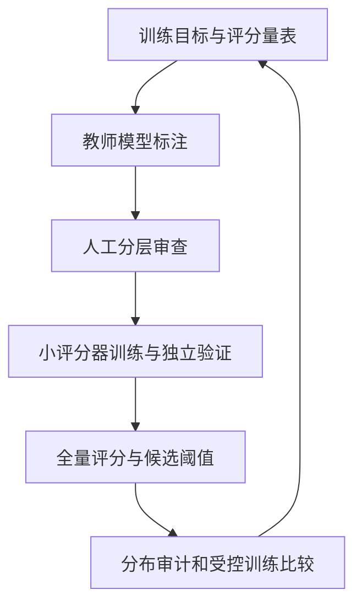

一篇写得流畅的产品宣传、一段准确但简短的 API 说明、一篇解释基础物理的教材，以及一组保留完整上下文的论坛问答，哪一种属于高质量数据？如果不先说明希望模型学会什么，这个问题没有唯一答案。

“高质量”至少包含两层判断：文本本身是否完整可信，以及它是否值得占用当前模型的训练预算。前一层可以通过抽取检查、事实审查与人工标注部分判断；后一层最终涉及训练后的表现。**质量分类器是一个选择工具，它学到的标准必须能够被说明和质疑。**

本文是第一卷第三篇。前一篇介绍[清洗与规则过滤](/posts/2026-10-15-llm-training-data-02-cleaning/)，这里进一步讨论如何用模型评分，以及怎样防止评分变成无法解释的数字。

## 一、先把质量拆成不同维度

至少可以分别观察以下维度：

| 维度 | 判断对象 | 容易混淆的概念 |
| --- | --- | --- |
| 完整性 | 抽取是否连贯，关键段落是否丢失 | 看起来顺畅不等于内容完整 |
| 信息性 | 是否表达具体事实、步骤或关系 | 信息密度高不等于事实正确 |
| 教育价值 | 是否适合解释、学习和推理 | 教育性高不等于覆盖所有文体 |
| 领域相关性 | 是否接近目标任务的内容分布 | 与目标相似不等于普遍优质 |
| 可信度 | 关键陈述是否有可靠依据 | 来源有名不等于每一段都准确 |
| 多样性贡献 | 是否补充少见主题、表达或情境 | 少见也可能只是噪声 |

这些维度有时一致，有时冲突。一份专业错误日志可能几乎没有自然语言叙述，却对系统排障有价值；一篇结构优美的文章可能把错误解释得很有说服力。因此，设计质量系统时，首先要写出目标和排除条件，而不是先选择一个打分模型。

对于通用预训练，可以将明显损坏的记录作为基础过滤对象，再将教育性、领域和文体当成可调节的选择维度。这样，未来改变训练目标时，不必重新从原始网页开始。

## 二、参考语料分类器究竟学到了什么

一种高效路线是把选定的参考语料作为正例，把网页池样本作为负例，训练 fastText、BERT 等分类器，再对网页排序。

DCLM 在其分类器实验中比较了不同正例来源，使用 OpenHermes 2.5 和高分 ELI5 帖子作为参考的一种配置表现较好，并采用较严格的筛选比例。这里的指令数据用于训练筛选器，不等于最终将全部网页改造成 SFT 对话。[DCLM 论文 §4.4](https://arxiv.org/html/2406.11794v1#S4.SS4)

理解这种方法的关键是：模型标签表示“来自参考分布”，不是“客观正确”。下面用一个理想化推导解释。

设正例分布是 $p_+(x)$，负例分布是 $p_-(x)$，训练采样的正例先验为 $\pi$。假设分类器经过良好校准，其输出为 $s(x)=P(y=1\mid x)$，由贝叶斯公式得到：

$$
\frac{s(x)}{1-s(x)}
=\frac{\pi}{1-\pi}\frac{p_+(x)}{p_-(x)}.
$$

当正负例等比例采样时，前面的先验比值为一。此时分数高，意味着文本更像参考来源而不像背景网页。这解释了参考语料为什么如此重要：改变正例，实际上就在改变“像什么”的方向。

这只是理想分类模型的推导。实际训练存在容量限制、标签噪声、分布漂移与不完全校准，不能直接将某个 fastText 分数代入公式，声称已经精确得到密度比。

一个值得专门检查的失败方式是来源捷径。假设正例总带有百科标题格式，负例没有，分类器可能靠格式判断，而没有真正识别解释质量。可以删除来源标识、按站点隔离验证集，并构造格式相同但内容不同的样本，观察模型是否仍能区分。

## 三、教育价值评分改变了什么

另一条路线先让大模型按照明确量表给网页评分，再用小模型学习这些标签，以降低全量处理成本。

FineWeb-Edu 使用这一思路选择教育性网页；其数据卡说明了评分器与筛选后的语料。[FineWeb-Edu 官方说明](https://huggingface.co/datasets/HuggingFaceFW/fineweb-edu)

中文的 CCI3.0-HQ 采用 Qwen2-72B-Instruct 产生教育性标注，并在冻结的 BGE-M3 表示上训练回归头，随后按阈值筛选。其模型实验采用约 0.5B 参数、100B 训练 token 等具体设置，结果应在这些条件内解读。[CCI3.0-HQ 论文 §2–3](https://arxiv.org/html/2410.18505v1)

从工程角度，这种路线包含两次近似。首先，大模型的评分近似人们想定义的价值；其次，小模型近似大模型的评分。小模型对教师标签的一致率高，只能说明第二次近似较好，不能独立证明第一层标准正确。

量表需要写清哪些信息值得奖励。例如，概念解释、因果关系、步骤完整性可以分别定义；“专业”则不宜只用术语密度衡量。对于中文技术内容，还应区分文字表达不够规范与知识价值不足。

评分提示本身也是训练配方的一部分。要求“适合基础教学”与要求“适合专业研究”，可能系统性偏向不同文本。即使两者最终都输出 0 到 5 分，也不能把分数视为同一量尺。

## 四、多个分数比一个总分更容易诊断

ChineseWebText 2.0 分别提供质量、领域和毒性等标注。质量部分使用 BERT 路线，领域分类等任务另有处理模块。这种组织形式让使用者能按不同目的组合条件。[论文 §3](https://arxiv.org/html/2411.19668v1#S3)

例如，可以在技术领域内比较不同质量分段，也可以检查某个过滤规则是否主要删除论坛和短问答。若只保留一个最终布尔值，这些分析就做不了了。

不过，多个模型的输出不能直接相加。一个概率、一个回归分数和一个领域置信度，其单位和校准方式不同。更清楚的起点是分别设置约束：先排除损坏文本，再按领域分桶，在各桶内用同一评分器排序，最后明确采样权重。

这里还要防止重复计分。假设两个评分器都主要奖励教科书式表达，把它们相加可能只是两次强调同一种偏好，而没有增加独立信息。审查评分器之间的相关性和分歧样本，往往比追求更多评分器更有价值。

## 五、困惑度是参考模型的熟悉程度

给定参考语言模型，对一个有 $T$ 个有效预测位置的文本，可以计算平均负对数似然：

$$
\ell(x)=-\frac{1}{T}\sum_{t=1}^{T}
\log p_{\mathrm{ref}}(x_t\mid x_{<t}),
\qquad \operatorname{PPL}(x)=e^{\ell(x)}.
$$

在相同 tokenizer、上下文策略与模型下，低困惑度表示参考模型较容易预测这段文本。它可能对应正常语言，也可能对应重复模板；高困惑度可能来自乱码，也可能来自专业术语或参考模型不熟悉的语言。

因此，用困惑度过滤时，需要观察两端的样本，而不能简单保留最低的一部分。不同 tokenizer 的每 token 困惑度不宜直接比较；中文与英文若被切成不同粒度的 token，同一个分数的意义也可能不同。

选择困惑度模型也会形成偏好。如果参考模型主要从新闻训练而来，专业文档中的高分可能只是领域差异。能够证明的结论是“更像该参考模型熟悉的分布”，而不是“更接近真实世界的知识”。

## 六、重要性重采样回答相关性问题

当目标分布明确时，可以考虑按照目标分布与背景分布的相对概率选择文本。理想权重形式为：

$$
w(x)\propto\frac{p_{\mathrm{target}}(x)}{p_{\mathrm{pool}}(x)}.
$$

DSIR 在低维特征空间估计重要性权重，以便在大语料上进行选择。它提供的是一种接近目标数据分布的方法，不是对文本进行全面事实核验。[DSIR 论文](https://arxiv.org/html/2302.03169v3)

这一形式也揭示了两个边界。第一，候选池必须覆盖目标分布需要的内容，重采样不能创造不存在的领域。第二，如果少数文本的权重非常大，采样会过于集中，通常需要检查权重分布并考虑平滑或截断；这些改动又会改变原始目标，应记录清楚。

目标参考集也不能直接拿最终测试题充当。否则数据选择过程已经围绕测试集进行优化，即使没有逐字复制题目，实验解释仍会受到影响。领域开发集与最终评测集应承担不同职责。

## 七、阈值选择是在改变整个分布

假设原始文本分布为 $p(x)$，评分器为 $q(x)$，采用硬阈值 $\tau$，则保留后的分布为：

$$
p_{\tau}(x)=
\frac{p(x)\mathbf{1}[q(x)\ge\tau]}
{\mathbb{E}_{x\sim p}[\mathbf{1}[q(x)\ge\tau]]}.
$$

分母就是保留概率。这个表达式说明筛选后每个样本的相对权重发生了变化；如果某类文体更容易获得高分，它在保留池中的占比就会上升。

看一个自拟算例：原始池有一千篇教材式文本和一千篇论坛文本。某阈值保留教材式文本的 80%、论坛文本的 20%，最后留下八百篇与两百篇。教材占比从 50% 变为 80%。这个算例不说明哪类更好，只说明“质量阈值”也同时充当了文体混合规则。

如果后续按文档采样，而教材平均更长，教材在 token 层面的占比还可能进一步升高。于是，第三篇的质量筛选与第五篇的数据混合其实在共同决定训练分布。

## 八、怎样评估评分器

评分器有三层评价，最好分别报告。

**标签层**检查它是否符合既定量表。可以看准确率、精确率、召回率以及阈值变化，但应按领域和语言拆分。一种稀少但重要的文本被全部拒绝，可能被总体均值掩盖。

**语料层**检查最终保留池。观察文体、长度、主题、来源集中度和重复情况，同时抽查拒绝集。只看通过的内容，会看不到误删。

**训练层**检查模型是否从这些内容中受益。固定模型、训练 token 和评测，再比较不同阈值。评分器标签 F1 提高，与语言模型下游效果提高是两个不同命题。

对一个二分类阈值，可以定义：

$$
\operatorname{Precision}=\frac{TP}{TP+FP},
\qquad
\operatorname{Recall}=\frac{TP}{TP+FN}.
$$

其中“正例”必须来自明确的审查标准。若审查样本按高低分段等量抽取，直接计算的总体精确率代表这个抽样集，而不一定代表全量语料。应保留分层权重或分别报告各层。

对评分模型验证集，还应按来源或近重复组隔离。来自同一模板的页面同时出现在训练与验证，容易高估评分器的泛化能力。若新版本主要面向另一个领域，旧验证集也不足以说明新领域效果。

## 九、合成改写需要新增一条来源链

面对低质量文本，除了丢弃，还可以尝试抽取知识、改写或生成不同表达。Nemotron-CC 原始研究探索了分类器组合与合成增强，并同时关注质量和长期训练所需的数据量。[Nemotron-CC 论文 §2](https://arxiv.org/html/2412.02595v1#S2)

这给出了新的设计空间，但也引入新的错误：改写可能删除限定条件，生成模型可能补入原文没有的事实，多种表达可能只是同一知识点的重复。

因此，生成记录应包含父文档 ID、生成模型版本、提示模板、采样配置与验证方式。一个父文档产生的所有改写应继承其数据划分，不能原文进训练、改写进测试。还应该分别统计自然内容与生成内容的 token，而不是只报告合计规模。

是否值得生成，需要比较生成和审核成本、信息增量与模型训练收益。生成后的文本更流畅，只能说明表面表达发生了变化，不能自动证明事实更可靠或知识覆盖更广。

## 十、为小规模研究选择一个可解释起点

建议先使用基础清洗与一个定义明确的评分器，保存原始分数，不立即叠加多个复杂模型。建立一组覆盖不同领域、长度和文体的固定审查样本，再比较少量候选阈值。

如果进一步进行训练对照，可以固定保留 token 总量，对比随机采样和评分筛选。随后再观察领域构成，判断收益可能来自文本质量、领域变化还是重复减少。若希望单独研究评分本身，则还需控制领域配比；这与研究“完整筛选策略的总效果”是不同的实验问题。

| 关键判断 | 证据性质 | 怎样检查 |
| --- | --- | --- |
| 参考分类器的输出与参考分布有关 | 贝叶斯关系下的推导 | 改变正例并分析分歧样本 |
| 教育筛选可服务知识与推理训练 | 相关项目在限定设置中的报告 | 同预算训练与多维评测 |
| 提高阈值会改变语料分布 | 条件分布公式与教学算例 | 分层保留率和来源占比 |
| 多评分器组合或合成改写适合本地任务 | 待验证的选择 | 对照成本、错误与训练结果 |

两个值得留下的问题：如果评分器的标签准确率提高，为什么语言模型可能没有变好？如果中文论坛被大量删掉，你会如何判断这是有效降噪，还是失去了重要的表达和知识来源？

下一篇讨论[去重与评测污染](/posts/2026-10-15-llm-training-data-04-dedup/)。评分再高的文档，如果被复制了无数次，仍可能让有限训练预算失去应有的覆盖面。
