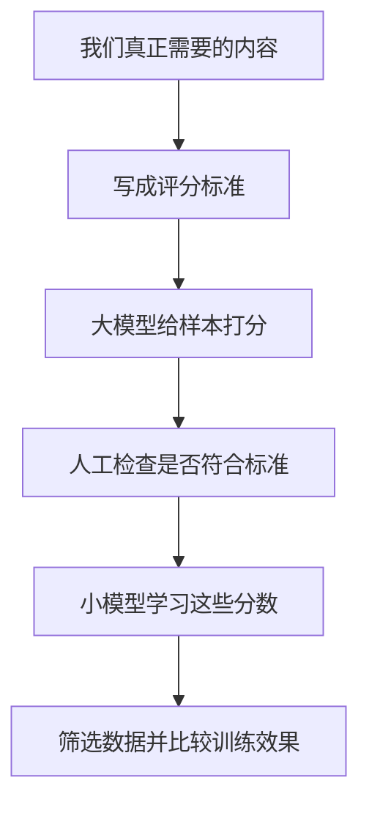

经过清洗，手里留下了几类能正常阅读的文本：一篇解释梯度下降的教程，一段准确的 API 说明，一篇写得很流畅的产品宣传，还有一组技术论坛问答。

如果训练预算有限，只能保留一半，应该留下哪些？

这个问题比“删掉乱码”难得多。教程适合学解释，API 文档适合学具体用法，论坛可能包含教材没有写的排障经验。**高质量不能只理解成写得漂亮，还要问它对这次训练有什么用。**

这是第一卷第三篇，接着[网页清洗](/posts/2026-10-15-llm-training-data-02-cleaning/)。我们仍然围绕中文技术模型，讨论怎样给文本评分，以及为什么评分高不等于模型一定学得好。

## 先写标准，再找评分模型

如果让人给文章打分，第一件事应该是告诉他按什么标准打。让模型打分也是如此。

“优质、专业、有价值”太宽泛。可以拆成几个能观察的问题：

| 要看什么 | 具体问法 |
| --- | --- |
| 内容完整 | 解释是否缺了关键步骤，表格和代码是否残缺 |
| 信息具体 | 是否给出事实、条件、步骤或例子，而不只是空话 |
| 教育价值 | 是否帮助读者理解一个概念或过程 |
| 领域相关 | 是否属于模型需要学习的领域 |
| 可信程度 | 关键说法有无可靠依据，是否存在明显错误 |
| 覆盖补充 | 是否补充了当前数据里少见但有用的内容 |

这些问题不能总用一个分数回答。一份错误日志可能没有教学式解释，却很适合排障模型；一篇长教程可能结构漂亮，却把概念讲错。

所以第一版可以先过滤明显损坏的文本，再把教育价值、领域和文体分别记录。以后任务变了，还能重新选择，不必把所有低分内容永久丢掉。

## 方法一 让分类器学习什么文本像参考材料

一个直观办法是准备两组文本：一组来自我们选定的参考材料，另一组来自普通网页。给两组加上不同标签，训练一个分类器，再让它给大网页池打分。

这样做的吸引力是成本低。分类器不需要逐句解释文章，只要学会两组材料的区别，就能较快处理很多文本。

DCLM 比较过不同参考来源，其中使用 OpenHermes 2.5 和高分 ELI5 帖子的一种配置取得较好的实验结果。这里的指令数据用于训练筛选器，并不是把整个预训练池改成对话数据。[DCLM 分类器实验](https://arxiv.org/html/2406.11794v1#S4.SS4)

但它到底学会了什么？先用大白话说：**更像参考材料，不一定等于更真实、更有用。** 如果正例都是教材，分类器可能喜欢教材文风；如果正例带固定标题，它还可能只记住了标题格式。

### 分数与参考来源有什么关系

如果想进一步理解，可以看下面的理想化关系。设 $p_+(x)$ 表示参考材料出现文本 $x$ 的概率，$p_-(x)$ 表示背景网页出现它的概率；训练时正例所占比例为 $\pi$。假设分类器能正确估计正例概率 $s(x)$，由贝叶斯公式可以得到：

$$
\frac{s(x)}{1-s(x)}
=\frac{\pi}{1-\pi}\frac{p_+(x)}{p_-(x)}.
$$

左边是“被判成正例的机会”与“被判成负例的机会”之比。右边说明，这个比值既受正负例采样比例影响，也受文本更像哪一组影响。

假设正负例各一半，并且模型确实校准得很好，$s(x)=0.8$ 对应的比值就是 $0.8/0.2=4$。在这个理想设定里，这段文本在参考分布中相对更常见。它**不表示文章有 80% 的事实正确率**。

真实分类器还有标签噪声、容量限制和校准误差，不能把任意一个分数直接当成精确概率比。这个推导的用途，是提醒我们：选什么正例，就是在告诉筛选器偏向什么。

### 怎样发现分类器走了捷径

可以把同一篇文章换一个标题格式，再看看分数是否大变；也可以去掉来源标记，或者让训练集与验证集来自不同网站。

如果正文几乎不变，只改“百科式标题”就能显著提高分数，那么分类器可能学到的是格式。此时继续调高阈值，未必是在提高内容质量。

## 方法二 先让大模型评分，再训练便宜的小评分器

另一条路线是写清评分量表，让大模型给一批文本打分，再训练一个较小的模型模仿这些分数。

这样既能利用大模型处理复杂要求的能力，又不必为全量网页都支付同样的推理成本。FineWeb-Edu 采用了这种教育价值筛选思路。[FineWeb-Edu 数据卡](https://huggingface.co/datasets/HuggingFaceFW/fineweb-edu)

中文的 CCI3.0-HQ 使用 Qwen2-72B-Instruct 产生教育性标注，在冻结的 BGE-M3 表示上训练回归头，随后筛选数据。论文中的模型实验有约 0.5B 参数、100B 训练 token 等具体条件，不能脱离条件复述成“教育数据必然更好”。[CCI3.0-HQ 论文](https://arxiv.org/html/2410.18505v1)

这里实际上有两道关：

第一道关是大模型是否理解了标准。第二道关是小模型是否学会了大模型的判断。

小模型模仿得很像，只能说明第二道关做得不错。如果教师模型本来就误判了专业文档，学生会把偏差一起学走。训练时“学生和老师一致率很高”，因此不是整个方法有效的充分证据。

对于中文技术文本，量表应明确奖励哪些东西，例如解释条件、操作步骤和必要限制。不要只奖励术语多、篇幅长，否则一段简短准确的答案可能不如一篇堆满术语的空文。

## 方法三 看参考模型是否容易预测这段文本

困惑度 PPL 常被用来筛选文本。名字不直观，可以先理解成：**对这个参考语言模型来说，这段文字有多难猜。**

若参考模型给真实后续 token 的概率总是很低，这段文本的平均损失会高，困惑度也会高。公式是：

$$
\begin{aligned}\ell(x)&=-\frac1T\sum_{t=1}^{T}\log q_t,\\q_t&=p_{\mathrm{ref}}(x_t\mid x_{<t}),\\\operatorname{PPL}(x)&=e^{\ell(x)}.\end{aligned}
$$

这里 $T$ 是有效预测位置数，$p_{\mathrm{ref}}$ 是参考模型给真实 token 的概率。先取负对数，是为了让“给正确答案的概率越高”对应“损失越小”；再对位置平均，避免只因为文章长就有更大总损失。

用一个简化算例理解：如果每个真实 token 都被赋予 0.5 的概率，PPL 就是 2；如果都只有 0.25，PPL 就是 4。这是人为设定的概率例子，不是实际网页统计。

问题在于，容易预测未必有用。反复出现的模板可能很容易猜；陌生的专业术语可能很难猜，但正是我们想让模型学习的。

因此，不宜只保留最低困惑度文本。应该查看高低两端都有什么，并固定参考模型、分词器和上下文处理方式。不同分词器切分粒度不同，每 token 的 PPL 不能直接比大小。

## 方法四 让选出的文本更接近目标领域

假设目标是技术问答，我们可以准备一份代表目标领域的材料，再从大池中增加相似内容的入选机会。重要性重采样就是这一方向。

理想权重写成：

$$
w(x)\propto\frac{p_{\mathrm{target}}(x)}{p_{\mathrm{pool}}(x)}.
$$

直觉是：某类文本在目标中很常见、在大池中却很少，就应当提高它的相对权重。DSIR 在较低维的特征空间中估计这种权重，以便处理大语料。[DSIR 论文](https://arxiv.org/html/2302.03169v3)

它解决的是“更接近什么内容”的问题，不是逐条核验事实。如果候选池根本没有我们需要的内容，再怎么重采样也变不出来。如果少数样本权重过高，又可能反复选中同一批内容。

目标参考材料也不能直接使用最终测试题。否则我们已经围绕答案调整了训练材料，再用同一套题报告泛化表现就不独立了。

## 阈值高一点，究竟改变了什么

考虑一个自拟数据池：有一千篇教材式文本和一千篇论坛文本。某个教育评分阈值保留了 80% 教材、20% 论坛，结果留下八百篇与两百篇。

教材占比从一半变成了八成。看起来只是调了一个“质量阈值”，实际上还改了文体比例。

用公式表示，原始分布为 $p(x)$，分数为 $q(x)$，阈值为 $\tau$，保留后的分布是：

$$
p_\tau(x)=
\frac{p(x)\mathbf{1}[q(x)\ge\tau]}
{\mathbb{E}_{x\sim p}[\mathbf{1}[q(x)\ge\tau]]}.
$$

指示符 $\mathbf{1}$ 表示达到阈值时取 1，否则取 0；分母表示总共保留了多少概率。它只是把“删掉低分，再重新计算剩余占比”写得更精确。

如果教材平均更长，最后它贡献的 token 比例还可能超过八成。所以质量筛选与[数据混合](/posts/2026-10-15-llm-training-data-05-mixture/)不是互不相关的两步。

## 多个分数能帮助诊断，但不能随便相加

ChineseWebText 2.0 分别组织质量、领域和毒性等信息，这让使用者能按不同问题筛选。[项目论文](https://arxiv.org/html/2411.19668v1#S3)

我们也可以先区分损坏程度、领域和教育性，再在目标领域内观察评分。不过，一个概率、一个 0 到 5 分的评分、一个领域标签，没有相同单位，不能直接相加。

两个评分器也可能只是重复奖励同一种文风。与其不断增加评分模型，不如先看它们判断不同的样本：它们的分歧来自内容，还是长度、格式和来源？

## 怎样验证评分真的有用

至少要分三层检查。

**先看标准学对没有。** 人工按量表判断一批样本，再比较评分器。精确率关注“选出来的里面有多少符合标准”，召回率关注“本来符合标准的里面找回了多少”。

假设选出 100 篇，人工认为其中 80 篇符合标准，而审查范围里实际有 160 篇符合标准：精确率是 $80/100=80\%$，召回率是 $80/160=50\%$。两者说明的问题不同。若人工样本专门偏向疑难案例，这些数字也不能直接当作整个数据池的表现。

**再看数据变成什么样。** 统计领域、文体、长度、来源和重复情况，也抽查拒绝的内容。如果技术论坛几乎消失了，要知道是过滤掉广告，还是丢掉了排障经验。

**最后看模型是否受益。** 固定模型、分词器、训练 token、优化设置和评测，对比随机取样与评分筛选。若研究评分本身，还要尽量固定领域比例；若研究整个筛选方案的实用效果，就同时报告领域变化。

可以先提出一个待检验的预测：教育筛选可能更有利于解释型任务，但未必同样有利于简短 API 查询。分别测试这两类能力，比只看总分更容易理解结果。

## 合成改写是另一种选择，也会增加新的错误

不合适的文本除了删除，还能尝试改写。Nemotron-CC 探索了分类器组合和合成增强。[Nemotron-CC 论文](https://arxiv.org/html/2412.02595v1#S2)

改写可能补足表达，也可能删掉限制条件、补入错误事实。原文生成了十个版本，并不自动等于十份新知识。

因此，记录原文 ID、生成模型、提示与采样配置；同一原文的改写应放在同一个数据集合，避免原文进训练、改写进测试。比较时，还要把生成和审核成本算进去。

| 关键结论 | 支持到哪里 |
| --- | --- |
| 参考分类器偏向所选参考分布 | 理想贝叶斯关系解释方向，实际分数还受误差影响 |
| 困惑度表示参考模型的预测难度 | 不等于事实正确率或普遍质量 |
| 阈值会改变领域和文体占比 | 可以由保留比例直接推导 |
| 某个评分器提高本地模型能力 | 必须由受控训练与相关任务评测回答 |

最后想两个问题：一个评分器越来越像教师模型，为什么语言模型仍可能没有进步？如果高分文本反复出现，继续提高阈值可能带来什么问题？

下一篇就处理这个问题：[怎样识别重复，以及怎样避免测试题混进训练](/posts/2026-10-15-llm-training-data-04-dedup/)。
