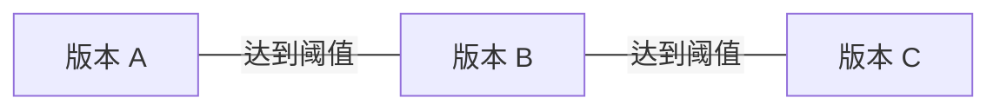

假设找到一篇很好的技术教程。原站有一份，转载站有一份，手机版还有一份。几个月后再次抓取，又得到三份。

现在文件夹里多了六篇文章，模型能学到的独立内容却没有增加六倍。如果这些副本被反复抽中，有限的训练预算就会花在重复内容上。更严重的情况是，文件夹里混进了测试题和答案解析：模型答得好，可能因为练过原题。

这一篇区分两件事：**去重是在训练材料内部找重复；去污染是在训练材料与评测之间找不该出现的重叠。** 两者可以共用匹配工具，但最后怎样处理，不能用同一套规则。

这是第一卷第四篇，接着[质量筛选](/posts/2026-10-15-llm-training-data-03-quality/)。下面从最简单的“文字完全相同”开始，再解释 MinHash 和 LSH 为什么会出现。

## 先决定要找哪一种重复

看见两篇文章相似，不代表应该删掉其中一篇。两位作者分别解释梯度下降，虽然讲同一个概念，也可能提供不同例子和视角。

真正要先分清的是重复发生在哪里：

| 情况 | 简单例子 | 可以从什么方法开始 |
| --- | --- | --- |
| 文件重复 | 同一个分片下载两次 | 文件校验和 |
| 整篇相同 | 两个网址的正文完全一样 | 正文指纹 |
| 小幅修改 | 正文相同，只换了日期与页脚 | 文字片段相似度 |
| 局部复制 | 长文章里复制了一整段教程 | 段落或局部包含检查 |
| 主题相近 | 独立解释同一个知识点 | 先判断用途，不直接删除 |

本篇主要处理复制和近重复。所谓近重复，就是文字有一些变化，但大段内容仍然相同。

## 最简单的方法 给正文做一个指纹

把匹配文本交给稳定哈希算法，会得到一个固定长度摘要。相同文本得到相同摘要，就可以很快分组，不必对所有正文逐字比较。

这里的“匹配文本”是[清洗篇](/posts/2026-10-15-llm-training-data-02-cleaning/)介绍过的专用副本。先统一换行、处理明确无意义的差异，再计算指纹。足够长的密码学摘要碰撞概率很低；需要严格确认时，还可以对摘要相同的文本再比较一次原内容。

规则不能过于激进。比如：

```text
将学习率设为 0.001，每 100 步评测一次。
将学习率设为 0.01，每 1000 步评测一次。
```

如果为了“忽略小差异”把数字全部删掉，两段不同的配置就会变成同一段。删掉大小写和缩进，也可能破坏代码含义。

精确去重的边界因此很清楚：它能快速找到按既定规则完全相同的文本，找不到所有小改写。删除副本后，还应保留副本到代表文档的映射，不能把其他来源一起忘掉。

## 有少量改动时 把文章拆成连续小片段

一篇长文只多了一行日期，整篇指纹就会不同。为了识别这种情况，可以把文本拆成很多连续的小片段，看两篇共享多少片段。

这种片段叫 **shingle**。假设每两个汉字组成一个片段：

```text
A：模型学习数据
B：模型学习知识
```

A 的片段集合是“模型、型学、学习、习数、数据”，B 的片段集合是“模型、型学、学习、习知、知识”。两者共有三个片段，总共出现七种不同片段。

Jaccard 相似度就是“共有的种类”除以“合起来的全部种类”：

$$
\begin{aligned}J(A,B)&=\frac{|A\cap B|}{|A\cup B|}\\&=\frac37\approx0.429.\end{aligned}
$$

这个短句例子只是解释算法，不是建议用 0.429 或字符二元组作为真实语料阈值。方法背景可见[信息检索教材的近重复章节](https://nlp.stanford.edu/IR-book/html/htmledition/near-duplicates-and-shingling-1.html)。

片段单位可以是字符、词或模型 token。片段越短，普通短语越容易撞上；越长，局部小改写越容易让片段不再一致。文本短于片段长度时还要单独处理，不能把所有空集合归成同一组。

### 一个重要的漏检情况

假设一篇短文完整地出现在一篇很长的文章里。短文的片段全部被复制了，但长文还包含很多其他片段，导致 Jaccard 的分母很大，相似度反而不高。

如果关心“短文是否被全文包含”，就应该看短文片段被覆盖了多少，或者直接做局部匹配。整篇 Jaccard 回答的是整体重叠程度，不适合代替所有包含关系。

## 文档太多时 MinHash 用短签名估计相似度

即使已经有了片段集合，百万篇文档两两比较仍然很贵。若有 $N$ 篇，文档对大约是 $N(N-1)/2$ 个；文档数量翻倍，比较量接近四倍。

MinHash 的想法是：不保存所有片段来比较，而是给每个集合做一个较短的“签名”，通过签名估计 Jaccard。

先想象把所有可能的片段随机排队。每篇文档只记住属于自己的、排在最前面的那个片段。

两篇文档什么时候会记住同一个？只有当它们合起来的片段中，排在最前面的恰好属于共有部分。共有部分占所有部分的比例，就是 Jaccard。因此，在理想随机排列下：

$$
\begin{aligned}a&=h_{\min}(A),\\b&=h_{\min}(B),\\P[a=b]&=J(A,B).\end{aligned}
$$

这就是 MinHash 的核心。一次排队太不稳定，就换很多个独立排列，分别记录最前面的片段。若共有 $m$ 个签名位置，就用对应位置相同的比例估计相似度：

$$
\begin{aligned}I_j&=\mathbf1[h_j(A)=h_j(B)],\\\widehat J(A,B)&=\frac1m\sum_{j=1}^{m}I_j.\end{aligned}
$$

例如，100 个对应位置里有 80 个相同，估计值就是 0.8。它是估计，不是精确结论。注意比较的是第一个对第一个、第二个对第二个，不能把签名值混成一堆再数相同数量。

理想独立条件下，估计方差为 $J(1-J)/m$。签名越长，波动通常越小，但计算、存储与传输更贵。实际实现通常用哈希族近似随机排列，还要考虑哈希设计与碰撞。所有文档必须使用相同的片段定义、规范化规则和种子。

## LSH 先找值得比较的候选

MinHash 把每篇文章压缩成短签名，但如果仍然两两比较所有签名，文档对数量没有变。

LSH，也就是局部敏感哈希，进一步解决“先找谁来比较”的问题。它把签名分成几段，只要任意一段完全相同，就把两篇文档放进候选名单。

设共有 $b$ 段，每段 $r$ 行，真实相似度为 $s$。在各签名行独立的理想条件下：

- 一行相同的概率是 $s$。
- 一整段都相同的概率是 $s^r$。
- 所有段都不相同的概率是 $(1-s^r)^b$。

所以至少一段相同、成为候选的概率为：

$$
P(\text{候选}\mid s)=1-(1-s^r)^b.
$$

取 $b=14,r=8$，公式给出的教学数值如下：

| 真实相似度 | 成为候选的概率，约 |
| --- | --- |
| 0.50 | 5.3% |
| 0.75 | 77.2% |
| 0.90 | 99.96% |

这说明候选生成是一条概率曲线。相似度达到 0.75，不意味着必然被找到；低于它，也不意味着绝不会进入候选。

候选还可以进一步计算更精确的相似度，再决定是否重复。有些流程直接按签名碰撞连边，速度和误差取舍不同。把“进入候选”和“确认删除”分开记录，调试会容易很多。

模板页还可能形成超大的候选桶。如果为了节省资源截断这些桶，需要记录截断量，因为这会产生漏检。

## 分成一组以后 为什么不能随便只留一篇

假设 A 与 B 很像，B 与 C 也很像，但 A 与 C 已经不那么像。



按连通关系分组时，三篇仍会进入同一组。这只表示它们之间能沿着相似关系连起来，不表示任意两篇都超过阈值。一份不断更新的文档，可能通过相邻版本形成很大的组。

如果整组只保留一篇，就可能丢掉不同版本的重要变化。挑最长的可能挑到广告最多的，挑最新的也未必最完整。需要明确代表选择规则，检查大组与长链，并用稳定的次级排序避免执行顺序影响结果。

还有一个区别：**分组不等于删除。** 可以先把相关文档放在同一组，防止它们跨越训练与测试；是否全部用于训练、保留几份，是另一项决定。

## 去得越多 为什么不一定越好

去重会减少重复，也会改变不同内容出现的比例。如果技术教程转载很多，普通短文很少转载，去重之后两者的比例就会变。

FineWeb 的去重比较中，跨抓取批次全局处理与批次内部处理并没有产生简单的“越彻底越好”关系，具体保留顺序也影响了结果。[FineWeb 官方去重实验](https://huggingface.co/spaces/HuggingFaceFW/blogpost-fineweb-v1)

另一方面，Lee 等人的研究在其设置中观察到去重减少记忆性输出，并改善相关训练和评测问题。[ACL 2022 论文](https://aclanthology.org/2022.acl-long.577/)

这两点并不冲突。真正要问的是：去掉哪种重复，保留了哪一份，空出来的训练预算又由什么内容填上。原来重复的是好教程，后来补进的是广告页，那么效果下降不能只归咎于“去重没有用”。

## 训练与测试应该按什么单位分开

不要先把长文切成小块，再随机分配训练和验证。这样相邻段落可能落到两边，模型虽然没见过同一句话，却见过同一篇文章的大部分上下文。

更清楚的顺序是：先找原文、派生版本与重复组，再按组划分，最后在各个集合内切块。同一原文生成的改写，也应该继承这个关系。

分组单位取决于想评测什么。想看同一类来源的新文章，可以按文档组留出；想看没见过的网站，需要按来源留出；想看未来内容，需要按时间留出。后两种还要检查跨边界转载。

组大小不同，实际文档比例未必刚好是 90/5/5。为凑齐比例拆开一组，会破坏最初想保护的独立性。

## 测试题混进训练时 怎样处理

题目往往很短，可能藏在长网页中，也可能带着答案、解析、翻译或改写。仅比较整篇文档相似度容易漏掉。

可以从题面与长片段精确匹配开始，再检查局部覆盖、答案解析和可疑衍生版本，最后人工区分普通知识讲解与实质题目泄漏。

对于已经冻结的外部基准，应保护评测，从训练候选中排除重叠内容。不能随机决定把题目留在训练还是测试。

也不能扩大成“训练中不准出现测试涉及的知识”。模型应该学过相关知识；要避免的是提前练过题目及过于直接的答案材料。

报告时至少写出匹配规则、题目命中比例、重叠类型和处理数量。“没检出”只能说明这套方法没发现，不能保证绝对没有污染。清洁子集与完整评测的难度也可能不同，不能直接拿分数差当作污染带来的收益。

## 怎样设计一个能解释结果的去重实验

先比较三种处理：不额外去重、仅精确去重、精确加近重复去重。使用同一候选池，并固定后续训练的有效 token 预算。

在训练之前先预测：更强的近重复处理应该减少哪些副本，又最可能误伤哪些更新版本？抽查这些变化，比只看去重率更有帮助。

训练报告同时记录代表选择、来源比例、补充内容和重复组大小。若效果下降，依次检查：代表是否选错，内容覆盖是否减少，替补数据是否更差。这样才知道下一轮应该改哪一步。

| 判断 | 依据与边界 |
| --- | --- |
| MinHash 能估计 Jaccard | 理想随机排列下的数学性质 |
| LSH 不能保证找到所有超过某相似度的文档 | 候选概率公式；实际实现另有误差 |
| 同一重复组不一定两两相似 | 连通分组的定义 |
| 某个去重强度更适合本地模型 | 需要控制训练预算并检查伴随分布变化 |

最后两个问题：一篇短文被长文完整复制，为什么整篇 Jaccard 仍可能很低？如果去重后成绩下降，你需要哪些记录，才能知道该改算法、改保留规则，还是改补充数据？

下一篇讨论[模型究竟应该看多少中文、英文和不同领域的文本](/posts/2026-10-15-llm-training-data-05-mixture/)。
