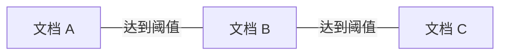

同一篇文章可能出现在原站、转载站、移动版和多个抓取月份中。把这些文件合起来，文件数增加了，独立内容却没有相应增长。如果其中还有评测题及解析，训练后的高分可能部分来自见过答案。

去重与去污染分别回答两个问题：训练池内部有哪些内容被过度重复，训练内容与评测之间又存在哪些不应有的重叠。两者共用一些匹配工具，但处理目标和保留策略不同。

这是第一卷第四篇。前一篇是[质量筛选](/posts/2026-10-15-llm-training-data-03-quality/)，完整目录见[第一篇](/posts/2026-10-15-llm-training-data-01-map/)。

## 一、先定义什么叫重复

重复可以发生在不同粒度。

| 粒度 | 例子 | 典型处理方向 |
| --- | --- | --- |
| 文件或记录 | 同一分片下载了两次 | 文件校验与记录 ID 检查 |
| 整篇正文 | URL 不同但正文相同 | 规范化后精确指纹 |
| 近重复文档 | 增加日期、页脚或少量编辑 | shingle 相似度与候选检索 |
| 段落或长片段 | 不同文章引用同一大段模板 | 段落指纹、子串匹配 |
| 语义 | 两篇文章用不同表达解释同一概念 | 表示空间相似度与人工判断 |

这些对象不能用一种方法全部覆盖。哈希不同不代表信息不同；语义相近也不代表可以删除。两篇教材独立解释同一个原理，可能提供不同上下文，恰恰有学习价值。

因此，去重策略应该先说明希望消除的是复制、模板重复还是主题集中，再选择算法。把所有相似都视作冗余，会把知识的多种表达一并删除。

## 二、精确去重是最容易建立的基线

对规范化后的匹配文本计算稳定摘要，相同摘要进入同一候选组。若需要严格确认，可以对摘要相同的文本进一步比较正文，避免把哈希碰撞当成完全一致。实际工程中使用足够长的密码学摘要可以让偶然碰撞风险很低，但仍应区分“摘要相同”与数学上绝对无碰撞。

规范化规则决定“精确”的含义。只统一换行与 Unicode 表示，保留的差异较多；去掉数字、标点、大小写和所有空白，匹配更激进，也可能合并本来不同的内容。

例如下面两句自写文本，若将数字全部删除，会变成相同形式：

```text
将学习率设为 0.001，每 100 步评测一次。
将学习率设为 0.01，每 1000 步评测一次。
```

这些差异对训练说明很重要。正文与匹配副本应分开，指纹也要记录规范化版本。对于代码，缩进、大小写和标点的语义更强，更不能沿用自然语言中的激进变换。

精确去重后需要保留所有来源的映射。只留下代表文本却丢掉其他来源，会削弱后续追溯与集合污染检查。

## 三、用 shingle 描述局部文字重叠

为了识别小改动，可以把文档转换为连续的 $k$ 个单位组成的片段集合，称为 shingle。单位可以是字符、词或模型 token，必须写清。然后使用 Jaccard 相似度：

$$
J(A,B)=\frac{|A\cap B|}{|A\cup B|}.
$$

这种集合表示和近重复检索方法可参见[《Introduction to Information Retrieval》相关章节](https://nlp.stanford.edu/IR-book/html/htmledition/near-duplicates-and-shingling-1.html)。

用两个自写短语演示字符二元组：

```text
A：模型学习数据
B：模型学习知识
```

得到：

$$
A=\{\text{模型},\text{型学},\text{学习},\text{习数},\text{数据}\},
$$

$$
B=\{\text{模型},\text{型学},\text{学习},\text{习知},\text{知识}\}.
$$

交集有三个元素，并集有七个，因此 $J=3/7\approx0.429$。这里使用极短文本和二元组只是方便说明，不能作为生产阈值。

$k$ 越小，常见短片段越容易共享；$k$ 越大，对局部改写越敏感。文档长度小于 $k$ 时，集合可能为空，必须安排单独策略，不能让所有空集合自动归为同一重复簇。

Jaccard 还存在长度边界。若一篇短文的全部 shingle 都被一篇长文包含，交集可能相对并集很小。这时若关心“短文是否完整出现在长文中”，需要包含率或局部片段匹配，而不是只看整篇 Jaccard。

## 四、MinHash 为什么能够估计 Jaccard

直接两两比较 $N$ 篇文档，需要约 $N(N-1)/2$ 次比较；大规模语料无法接受。MinHash 先用固定长度签名近似集合。

在理想的随机排列下，对集合取排列位置最小的元素。两个集合的最小元素相同，当且仅当它们并集中最先出现的元素属于交集。由于并集中每个元素成为第一个的机会相同，得到：

$$
P[h_{\min}(A)=h_{\min}(B)]=J(A,B).
$$

这是理解 MinHash 的关键。使用 $m$ 个独立排列，统计同一签名位置相等的比例，可以估计相似度：

$$
\widehat{J}(A,B)=\frac{1}{m}\sum_{j=1}^{m}
\mathbf{1}[h_j(A)=h_j(B)].
$$

在独立理想假设下，它的方差为 $J(1-J)/m$。增加签名数能降低估计波动，但增加计算、存储和通信成本。实现中通常以哈希族近似随机排列，其误差还受哈希设计和碰撞影响。

注意比较的是**相同位置**的签名值，不是将所有签名随意放进一个集合后计算重合数。哈希种子、规范化和 shingle 定义必须对全部文档一致。

## 五、LSH 的相似度阈值是一条概率曲线

有了签名，仍不想比较所有文档对。局部敏感哈希 LSH 可把签名分成 $b$ 个 band，每个 band 有 $r$ 行。任意一个 band 完全相同，就将两个文档视为候选。

设真实 Jaccard 相似度为 $s$。在各签名行独立的理想假设下，一个 band 完全相同的概率是 $s^r$，所有 band 都不相同的概率是 $(1-s^r)^b$，所以：

$$
P(\text{候选}\mid s)=1-(1-s^r)^b.
$$

这段推导解释了为什么“阈值 0.75”经常容易被误读：候选生成不是在 0.75 处突然由零变成一。取 $b=14,r=8$，按公式得到下列教学数值：

| 相似度 $s$ | 成为候选的概率，约 |
| --- | --- |
| 0.50 | 5.3% |
| 0.75 | 77.2% |
| 0.90 | 99.96% |

这组参数对应一种常见签名布局，表格是公式计算而非实测召回率。真实召回率还受分词、哈希、数据分布与实现影响。工程上可以再对候选计算更精确的相似度；也有流程直接按碰撞连边，这会得到不同的误删与漏检行为。

参数选择需要同时看候选量和错误。某些模板会形成巨大的候选桶，如果简单截断桶，必须记录被截断的规模，否则所谓全量去重已经带有未披露的漏检。

## 六、重复簇中的文档并非两两相似

假设 A 与 B 达到阈值，B 与 C 达到阈值，但 A 与 C 没有达到阈值。使用连通分量或并查集时，三者仍然进入同一簇。这是传递闭包，不是“簇内任意两篇都超过阈值”的证明。



因此，保留一篇代表之前，应观察大簇、链式连接和代表与成员之间的距离。一个持续更新的文档系列，可能通过相邻版本连接成很大的簇，直接只留一篇会丢失历史内容。

代表选择也会影响质量。选择最早抓取、最新抓取、正文最长、评分最高，各自有取舍。最新版本可能更完整，也可能带更多广告；最长版本可能保留细节，也可能只是模板更多。使用确定性的规则与稳定的次级排序，能避免线程执行顺序改变结果。

还要区分两个动作：为了集合划分把相关记录归在一组，以及为了减少训练重复只保留部分记录。分组不必自动意味着删除，它可以只保证关联内容不跨越训练与评测集合。

## 七、去重更多为什么不一定更好

FineWeb 的研究曾比较跨抓取批次的全局去重与批次内部去重。特定的全局处理顺序使较早批次留下的数据质量发生变化；其结果没有支持“去得越彻底越好”的简单结论。[官方技术报告中的去重实验](https://huggingface.co/spaces/HuggingFaceFW/blogpost-fineweb-v1)

这一观察可以从分布角度理解。假设一类内容经常被转载，另一类内容几乎不被转载。统一去重会下调前者相对权重，而这种频率差异未必与内容价值一一对应。删除重复同时也是修改采样分布。

这不意味着应该放弃去重。Lee 等人的研究在其设置中观察到去重减少记忆性输出，并改善训练与评测相关问题。[ACL 2022 论文](https://aclanthology.org/2022.acl-long.577/)

更准确的问题是：重复的粒度、频率、来源和保留策略是什么？对于固定 token 预算，删除重复后，原有训练位置又由哪些内容填补？如果替补数据质量不同，训练变化就不仅是“重复率变了”。

可以分别报告精确重复率、近重复簇大小、去重后的来源比例，以及不同保留策略带来的差异。一个单独的“去重率 90%”无法说明这些事情。

## 八、划分集合要先确定独立单位

将长文切成小块之后随机划分，容易让相邻片段进入训练和验证。即使没有完全相同的句子，主题、叙述和答案也可能高度关联。

一个基本流程是：先恢复文档关系和重复簇，再以这些组为单位划分，最后在各集合内部切块。分组键可以是原文 ID、作品 ID、抓取版本族或近重复连通分量，具体选择取决于希望评测哪一种泛化。

如果目标是同来源新文档，文档组划分可能足够；如果目标是新网站或未来时间，应该考虑来源留出或时间留出，并重新检查跨边界复制。来源级划分更严格，但也会改变领域分布，不能把结果简单当成文档级划分的同一指标。

划分比例也不必强求精确记录数。组大小不同，按组稳定哈希得到的文档比例通常只接近目标。与其拆开大组凑到精确 90/5/5，不如保留独立性并报告实际分布。

## 九、评测去污染要匹配题目及其变体

评测重叠可能来自题面、选项、答案解析、翻译、改写或整套试卷。完全匹配只是起点。一个合理的审计可以分层推进：

1. 按固定规范化规则检查题面和长片段的精确重叠。
2. 使用较长 n-gram 与局部包含率寻找候选。
3. 检查答案解析、题目镜像及已知衍生版本。
4. 对可疑样本人工复核，区分通用短语与实质泄漏。

评测题往往比网页短，直接使用整篇文档的 Jaccard 阈值容易漏掉夹在长文中的题目。应从评测片段被覆盖的比例出发，同时设定最短匹配长度，减少普通短句造成的误报。

对已冻结的外部基准，处理优先级应保护评测集，从训练候选中排除重叠内容；不能随机决定哪一边留下。对于自行构建的集合，则可以先分组、再整体分配，并保留分组证据。

去污染也不应无限扩大成“训练中不能出现评测涉及的知识”。模型本来就需要学习相关知识。要排除的是会破坏评测独立性的题目、答案和过于直接的衍生内容。具体边界需要结合评测目标定义。

## 十、怎样报告污染程度

最好同时报告题目命中率、重叠长度或覆盖率、命中类型与处理数量，并保存去污染规则版本。采用一个方法未检出，只能说明在这个方法的检测范围内未发现，不能证明训练语料绝对无污染。

训练完成后的成绩可同时展示完整评测和预先定义的清洁子集，但两者的难度组成可能不同。如果清洁子集成绩下降，不能只凭差值估算“污染贡献了几分”；它可能恰好留下了更难的题。

对改写和翻译，语义检索可以帮助发现候选，却会引入新的误报。相同知识点的正常教材与测试题语义接近，不一定构成题目泄漏。检索、判定和删除应分成可追溯的阶段。

| 关键判断 | 证据性质 | 边界 |
| --- | --- | --- |
| MinHash 与 Jaccard 有概率关系 | 理想随机排列下的数学性质 | 实现使用近似哈希族 |
| LSH 候选概率不是硬阈值 | 独立假设下的公式推导 | 实测召回还取决于语料与实现 |
| 去重会改变训练分布 | 分布推理与 FineWeb 案例 | 不能由单次实验推出统一最佳策略 |
| 去污染未检出不等于绝对无污染 | 检测覆盖范围的限制 | 需记录规则和已知盲区 |

两个思考问题：为什么重复簇不能自动解释为簇内每两篇都高度相似？如果去重后的训练效果变差，怎样区分保留代表不合适、替补数据变差和重复本身有价值这几种解释？

下一篇进入[数据混合与采样](/posts/2026-10-15-llm-training-data-05-mixture/)。经过清洗、筛选和去重之后，模型真正看到的分布还要由训练配方决定。
