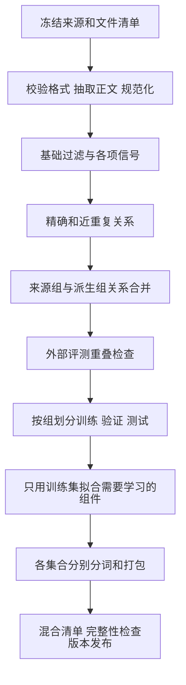

一份训练文本可以很简单：每行一个 JSON 对象，其中有一个 `text` 字段。但当模型训练结果发生变化，只有文本就不够了。需要知道它来自哪里，经历过哪些处理，与上一版相比删了什么，哪一批记录进入验证集，以及训练时是否真的按照计划读完。

可追溯语料的交付物应包含数据、构建说明和可验证的处理记录。目标是让未来的自己能够回答：**这一段训练输入为什么会出现在这里，如果改变某一步，应该从哪里重新构建？**

这是“大模型训练研究笔记”第一卷第六篇。前五篇分别讨论[语料地图](/posts/2026-10-15-llm-training-data-01-map/)、[清洗](/posts/2026-10-15-llm-training-data-02-cleaning/)、[质量](/posts/2026-10-15-llm-training-data-03-quality/)、[去重](/posts/2026-10-15-llm-training-data-04-dedup/)和[混合](/posts/2026-10-15-llm-training-data-05-mixture/)。本文给出小规模项目的构建方案与教学代码；它们不代表已经完成真实中英文语料的全量加工或训练。

## 一、从明确的研究范围开始

第一版可以围绕一个目标：构建中文为主、包含少量英文的技术与通用文本池，用来研究数据处理和随机初始化小模型训练。来源先限制在少数能够定位版本的公开语料或自有文本。

这里需要分清三种规模。几十条自写文本可以验证字段和控制流程；较小的真实切片可以观察分布、清洗与重复问题；足够支撑训练的正式语料还要依据模型、预算和资源测量决定。不要因为流程在教学样本上通过，就宣布已经验证了大规模质量。

本站已有[小模型全链路计划](/posts/2026-07-08-1b模型全链路实验计划/)。本文提供它的数据交接设计：先稳定数据版本，再将正式训练结果与该版本绑定。训练规模扩大时，延续同一来源清单和记录格式，而不是重新从一个无法解释的文件夹开始。

## 二、把来源清单作为入口

选择数据后，先登记获取对象，再运行处理。清单应同时记录逻辑身份和实际文件身份。

| 字段 | 作用 |
| --- | --- |
| `source_id` | 本项目内部稳定的来源名称 |
| `repository` 与 `revision` | 上游仓库与不可变提交标识 |
| `subset` 与 `files` | 使用哪个语言、抓取批次和文件集合 |
| `retrieved_at` | 何时实际获取文件 |
| `sha256` 与字节数 | 核对本地文件是否一致 |
| 许可文件位置与版本 | 保存当次选型依据，区分数据、代码与上游说明 |
| 获取限制与采样方式 | 解释为什么只有这个切片，以及它代表什么 |

对于支持版本参数的 Hugging Face 数据集，应明确指定仓库 revision，并保存解析后的文件清单。[Datasets 加载文档](https://huggingface.co/docs/datasets/loading)

单独写 `main` 或“最新版”不足以固定内容。数据卡发生变化、分片重排或添加抓取批次之后，下一次执行相同命令也可能读到不同数据。

如果使用远程流式读取，应记住网络内容仍在传输；它减少提前下载与本地落盘需求，不等于没有 I/O 成本。小规模审查可以使用流式接口，但正式可重建版本最好保留确切文件集合或选中记录清单。[Datasets 流式文档](https://huggingface.co/docs/datasets/stream)

## 三、样本记录应该保存什么

下面是一条自写的格式示例，文本和编号都用于教学，没有伪装成真实网页样本。

```json
{
  "id": "example-zh-001",
  "text": "梯度累积改变每次更新的样本组织方式，参数和优化器状态仍需存储。",
  "source": {
    "dataset": "author-example",
    "revision": "example-v1",
    "record_id": "example-zh-001",
    "locator": "examples/input.jsonl:1",
    "license": "author-owned"
  },
  "language": {"label": "zh", "method": "author-assigned"},
  "lineage": {"parent_ids": [], "group_id": "example-document-001"},
  "processing": {"normalizer": "nfc-lines-v1", "quality_score": null},
  "split": null
}
```

`id` 标识这条记录，`source.record_id` 对应上游记录，`parent_ids` 表示由哪些记录派生，`group_id` 表示划分时必须共同处理的关联组。四者不同：两条改写可以有不同 ID，但属于同一个原文组；两个来源的同文副本可以有不同上游 ID，却需要建立重复关系。

评分尚未执行时使用 `null`，不能用 `0` 占位。否则后续过滤可能把“未评分”误读成“最低分”。同样，未知许可、缺失 URL 和未检测语言都应保留明确状态，不应自动填入一个看起来正常的值。

必要时把较大的原始元数据放到独立索引中，用记录 ID 关联。训练需要的紧凑表示与研究需要的完整来源，可以分别存储，但必须能可靠互相定位。

## 四、处理阶段构成一张依赖图

一种适合小型文本项目的顺序如下。它是设计起点，具体项目可根据来源调整。



关系检测可以使用所有候选文本的指纹来避免跨集合重复，但这不意味着可以用最终测试集调过滤阈值。固定规则做隔离与根据测试成绩选择规则，是不同操作。

如果质量评分器来自外部固定模型，可以记录模型版本后运行；如果准备在本项目训练评分器，其训练标签与验证数据也需要隔离。如果重新训练 tokenizer，则只用划分后的训练文本拟合，再将同一个 tokenizer 应用于验证和测试。

同一文档的派生关系和重复关系必须联合考虑。假设原文 A 与另一个来源的 B 是重复，A 又生成了改写 C，那么划分时 A、B、C 都应处于同一关联组，不能先把 A 删除，再丢掉 A 与 C 的关系。

## 五、每个阶段需要明确输入输出

一个阶段可以输出三个对象：保留数据、决策日志与统计报告。

保留数据保留稳定 ID；决策日志记录被拒绝或被替换的对象及原因；统计报告用于汇总。在删除阶段，只要一个输入记录有且仅有一个最终去向，就可以验证：

$$
N_{\mathrm{input}}=N_{\mathrm{kept}}+N_{\mathrm{rejected}}+N_{\mathrm{quarantined}}.
$$

隔离区用于解析失败、缺失必需字段等尚不能做正常决策的记录。失败不应静默计入“低质量”。若阶段会将一个文档切成多个片段，上式就不再适用，应分别统计输入父记录、输出子记录与父子覆盖关系。

去重阶段还应输出代表映射，说明每个删除的副本由哪条记录代表。近重复阶段保存参数、候选规则与组 ID。评分阶段保存模型和提示模板版本。这样才能定位是数据变化还是处理变化造成结果差异。

每阶段的版本指纹可以由输入清单摘要、配置摘要、代码提交和工具版本组合产生。修改质量阈值时，只重建依赖它的下游；更换抽取器则可能需要重做指纹、评分、去重和分词。

## 六、一段小代码说明稳定划分

下面的 Python 代码仅演示匹配文本规范化、指纹和稳定的按组划分。它使用标准库；**假设 `group_id` 已由上游合并好所有重复与派生关系**。它不实现近重复检测、语言识别或全量语料清洗。

```python
import hashlib
import unicodedata


def normalize_for_match(text: str) -> str:
    """保留大小写、数字与行内缩进，仅统一表示和行尾空白。"""
    text = unicodedata.normalize("NFC", text)
    text = text.replace("\r\n", "\n").replace("\r", "\n")
    lines = [line.rstrip() for line in text.split("\n")]
    while lines and not lines[0].strip():
        lines.pop(0)
    while lines and not lines[-1].strip():
        lines.pop()
    return "\n".join(lines)


def text_fingerprint(text: str) -> str:
    matching = normalize_for_match(text)
    if not matching.strip():
        raise ValueError("empty document")
    return hashlib.sha256(matching.encode("utf-8")).hexdigest()


def split_group(group_id: str, salt: str = "example-split-v1") -> str:
    if not group_id:
        raise ValueError("missing group_id")
    payload = f"{salt}\0{group_id}".encode("utf-8")
    digest = hashlib.sha256(payload).digest()
    bucket = int.from_bytes(digest[:8], "big") % 1000
    if bucket < 900:
        return "train"
    if bucket < 950:
        return "validation"
    return "test"
```

使用稳定摘要，而不是 Python 内置 `hash()`，可以避免不同进程的哈希随机化改变划分。同一组始终得到同一结果；改变 salt 就相当于改变划分版本。

这个方法的目标比例是按组近似 90/5/5，不保证文档数或 token 数恰好符合比例。少量组时甚至可能没有验证或测试样本；因此正式构建仍要检查各集合是否非空、各语言领域是否有足够覆盖。若覆盖不足，应重新设计分组或分层策略，而不是根据模型成绩反复尝试 salt。

代码中的规范化用于匹配。即使它相对保守，也不能不经审查就替代所有训练正文，尤其是需要保留特殊空白的内容。

## 七、小切片抽样也需要可复现

读取前一万条记录很适合检查字段，但未必适合估计总体质量。分片可能按来源、时间或质量排序，开头的内容不能自动代表整个语料。

比较稳定的研究抽样是先按语言、来源、长度和评分区间分层，再保存选中 ID。若使用流式缓冲区打乱，应说明它是有限缓冲下的混洗，不能宣称是全量记录的均匀随机排列。Hugging Face 的流式文档解释了缓冲区及分片顺序的作用。[流式打乱说明](https://huggingface.co/docs/datasets/stream#shuffle)

全量扫描中的 reservoir sampling 可以得到另一种抽样方式，但仍然要遍历候选流；“不保存全部内容”不意味着“不读取全部内容”。本地资源有限时，可以采用预先选定分片的分层样本，并把结论范围限制在这些分片。

人工审查样本和训练样本也要分清用途。阈值附近的样本适合调试过滤器，却不适合直接估计全量误差。报告时写出抽样方法、各层样本量及汇总权重，比只报告一个“抽查通过率”更有解释力。

## 八、分词和打包不能丢失文档边界

完成集合划分之后，在每个集合内部独立分词。记录 tokenizer 文件摘要、特殊 token ID、是否插入 BOS/EOS、最大长度、截断方式和打包方式。

即使训练文件最终只保存整数 token，也应有旁路索引记录每段来自哪个文档、原始位置与来源组。发生异常生成、污染命中或数据撤回时，才能找到相关训练片段。

若把多个文档拼接成一个块，至少保存块内边界。EOS 可以向模型提供边界信号，但不会自动隔离注意力。是否允许跨文档注意、是否重置位置、哪些 token 被 mask，都需要与训练程序一致。

尾块处理也应显式配置。直接丢弃每个分片的不足长度部分，会使很多小分片损失更多内容；跨文件累积尾块能够减少浪费，但必须保证不跨越训练与评测集合。记录丢弃 token 数，才能回算实际配比。

若采用定长整数存储，dtype 应覆盖全部 token ID，包含后加的特殊 token；不能只根据正文中当前出现的最大 ID 选择类型。压缩格式、字节序与索引格式也应写入读取协议。

## 九、目录结构服务于重建和审查

可以为一个独立数据项目采用以下结构：

```text
configs/              来源、处理、去重、划分和混合配置
manifests/            固定文件清单、版本与校验和
data/raw/             原始输入或可重取的受控缓存
data/intermediate/    阶段产物与拒绝记录
data/processed/       划分后的正文与元数据
data/tokenized/       token 文件与边界索引
reports/              各阶段统计与抽样审查
releases/             最终清单、数据卡与构建信息
```

Git 通常保存配置、代码、清单和允许公开的报告。大规模原文、缓存、访问凭据和训练产物不应混在博客源码中。可公开的报告也需要检查是否包含未经处理的个人信息或不适合再分发的长段文本。

对于有限资源设备，不必同时保留所有阶段的全部副本。可以保留可重取的原始清单、关键中间产物和统计，删除可再生成的缓存；但必须能说明重建依赖外部对象是否仍可获取。

资源预算可以先按输入字节、输出字节、索引、临时排序文件和失败重试空间拆分。近重复去重常有全局签名与排序开销，仅估计最终文本文件大小会低估磁盘需求。

## 十、什么情况下才算构建完成

至少有三组验收。

**结构与完整性**：必需字段存在，ID 唯一，文本非空，文件校验和一致，记录计数能对账，错误记录有去向。生产读取器可以完成一次有限遍历，并正确报告结尾和异常。

**集合与来源**：关联组不跨集合，精确重复不跨集合，近重复与外部基准重叠按既定规则审计，各来源版本能够定位。不存在评分缺失被当成零、未知语言被静默归入英文等隐式替换。

**训练交接**：tokenizer 与模型词表兼容，token ID 不越界，loss mask 与边界策略一致，实际采样比例与计划接近，恢复后不会意外重读或跳过大段数据。

验收应区分必须为零的错误与允许存在的统计偏差。跨集合的同组记录是结构错误；小规模抽样比例没有精确达到 70% 则可能只是波动。把两者都当作模糊“警告”，会让真正的问题被忽略。

一个实际运行报告至少应填写以下项目，未运行的数值保持缺失，不填入预期结果：

| 报告部分 | 内容 |
| --- | --- |
| 构建身份 | 代码版本、配置摘要、输入清单摘要、执行环境 |
| 数量变化 | 每阶段输入、保留、拒绝、隔离与输出字节 |
| 分布变化 | 语言、领域、长度、质量分段、来源集中度 |
| 重复与划分 | 精确重复、近重复组、跨集合检查、评测命中处理 |
| token 产物 | tokenizer、总 token、特殊 token、尾块及 mask 统计 |
| 资源成本 | 运行时间、峰值资源、临时空间、失败与重试 |
| 审查结论 | 已观察的问题、适用范围、下一版修改理由 |

## 十一、训练恢复也属于数据可复现性

模型检查点通常保存参数、优化器和随机状态。若数据顺序不能恢复，相同检查点继续训练也可能读到不同样本。

因此，还需要保存分片顺序、当前位置、域采样器状态、epoch、混洗状态及并行工作配置。改变 worker 数量或分布式 world size 时，恢复语义可能变化；应说明是否保证完全相同的后续序列，还是仅保证近似相同的分布。

最小验收可以在固定配置下记录一小段数据 ID 序列：连续读取一次，再在中间保存状态并恢复，比较恢复后的下一段是否一致。这验证数据加载控制流程，不证明模型训练结果已经完全确定；GPU 运算等还可能有其他不确定来源。

## 十二、从数据版本连接到下一卷

这一卷的完整链条是：来源提供候选，清洗恢复内容，质量筛选改变偏好，去重建立独立关系，混合分配训练预算，工程记录让每次决定可追溯。

到后训练阶段，记录对象会变成指令、回答、偏好对或带奖励的轨迹，但来源关系不会消失。由同一预训练文档生成的多条问答，依然应该保留父文档；不同模型生成的答案，依然需要记录模型、提示与采样配置；偏好标签也依然有定义、标注误差和适用边界。

| 关键判断 | 性质 | 当前范围 |
| --- | --- | --- |
| 来源、配置与文件身份需要共同固定 | 本文工程设计 | 支撑重建与差异解释 |
| 同组稳定划分不保证精确比例 | 哈希分桶的性质 | 小样本仍需覆盖检查 |
| 构建通过不等于语料提高模型能力 | 验收层次的区别 | 模型效果需要训练对照 |
| 数据状态是训练恢复的一部分 | 读取顺序的工程要求 | 不等于全部计算完全确定 |

最后可以问自己：如果一份数据只保存了 `text`，下次发现评测污染时还能定位哪些受影响片段？如果模型效果改变，现有记录能否区分来源更新、过滤规则修改、tokenizer 变化与采样顺序变化？

当这些问题能够被具体记录回答，一份小语料就具备了继续扩展的基础。可以回到[第一卷目录](/posts/2026-10-15-llm-training-data-01-map/)，也可以沿着[小模型全链路计划](/posts/2026-07-08-1b模型全链路实验计划/)把数据版本交给训练。
