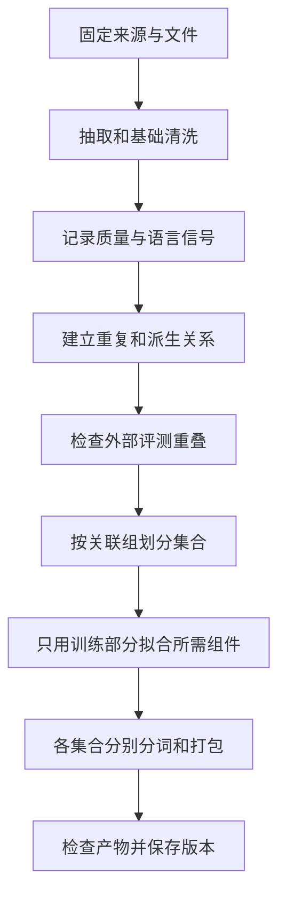

假设上周训练的小模型表现还可以，这周重新处理数据、重新训练，效果却变差了。

你打开数据目录，只看到 `train.jsonl`。每行只有一个 `text` 字段。原始数据是不是更新过？过滤阈值有没有改？重复文章保留的是不是另一份？验证集是不是重新随机分了？现在都说不清。

这就是为什么一份能用于研究的语料，不能只交付文本。**我们还要知道每条文本从哪里来、经过了什么处理，以及训练实际读了哪些内容。** 这些记录的作用，是让下一次出问题时有地方可查，让有效的改动能再做一遍。

这是第一卷第六篇，把[选来源](/posts/2026-10-15-llm-training-data-01-map/)、[清洗](/posts/2026-10-15-llm-training-data-02-cleaning/)、[质量筛选](/posts/2026-10-15-llm-training-data-03-quality/)、[去重](/posts/2026-10-15-llm-training-data-04-dedup/)和[混合采样](/posts/2026-10-15-llm-training-data-05-mixture/)接成一个小型工程。以下是设计与教学示例，不是一次已完成的真实语料构建报告。

## 第一版先交付什么

不用一上来处理几 TB。先把目标定为：构建一份中文为主、带一些英文的文本版本，能供小模型训练，并能解释它与上一版的差异。

可以分三步扩大规模：

1. 用几十条自写样本检查字段、拒绝记录和分组逻辑。
2. 用固定的真实小切片观察语言、领域、重复与误删。
3. 根据模型和资源预算决定正式数据量，再做训练比较。

第一步通过，说明流程能按设计走完，不说明数据质量足够好；第二步通过，也不说明模型必然受益。把这几层分开，工程进度会更真实。

最后的交付物不只是 `train.jsonl`，还应有输入清单、处理配置、数据划分、统计报告和训练读取说明。

## 先给输入做一份固定清单

“从某仓库下载最新版”很方便，却不能固定一份研究材料。仓库增加分片、调整内容以后，同一句命令可能读到不同数据。

我们需要同时记住两件事：**逻辑上是哪一版，实际上是哪几个文件。**

| 信息 | 将来能回答什么 |
| --- | --- |
| 仓库与不可变版本 | 上游内容有没有变 |
| 语言、子集、抓取批次 | 本次只用了哪一部分 |
| 文件名、字节数和 SHA-256 | 本地文件是否完整、是否与原记录一致 |
| 获取时间 | 本次何时取得内容 |
| 来源说明与使用条件的版本 | 当时依据哪份说明选择材料 |
| 抽样方式与选中记录 ID | 为什么恰好选中了这些样本 |

这里的清单常叫 **manifest**。可以把它理解为这次构建的材料明细，而不是另一个需要背下来的术语。

Hugging Face Datasets 支持用 revision 指定仓库版本；实际使用时还应保存解析后的文件清单。[加载文档](https://huggingface.co/docs/datasets/loading)

流式读取可以避免先下载全部文件，但数据仍要经过网络传输。它省的是提前存储，不是免去读取成本。正式版本仍需固定输入或选中记录，而不只是记“用了 streaming”。[流式读取文档](https://huggingface.co/docs/datasets/stream)

## 每条记录需要什么身份信息

下面是一条自写记录。先不要被字段吓到，重点看它如何回答“这是什么，来自哪里，和谁有关”。

```json
{
  "id": "example-zh-001",
  "text": "梯度累积改变每次更新的样本组织方式，参数和优化器状态仍需存储。",
  "source": {
    "dataset": "author-example",
    "revision": "example-v1",
    "record_id": "example-zh-001",
    "locator": "examples/input.jsonl:1",
    "license": "author-owned"
  },
  "language": {"label": "zh", "method": "author-assigned"},
  "lineage": {"parent_ids": [], "group_id": "example-document-001"},
  "processing": {"normalizer": "nfc-lines-v1", "quality_score": null},
  "split": null
}
```

其中几个 ID 容易混淆：

- `id` 是本项目这一条记录的编号。
- `source.record_id` 用来找上游记录。
- `parent_ids` 说明它由哪些记录生成或切分而来。
- `group_id` 表示划分训练、验证、测试时必须一起处理的关联组。

比如一篇原文生成了两个改写，三条记录的 `id` 不同，但属于同一个组。另一个数据源又收录了原文副本，也要把这个关系接进来。

这套来源与派生记录常叫 **数据血缘**。实际理解时，只需要想成“这条样本的来历”。

未评分使用 `null`，不要填 `0`。因为“还没打分”与“已经打了最低分”不是同一件事。缺失语言、来源或必要字段，也应明确标记，不要默认填成英文或其他看起来正常的值。

## 处理顺序为什么要明确

一套可作为起点的顺序如下：



其中最值得检查的是几个先后关系。

**先建立关系，再分集合。** 原文 A 与副本 B 重复，A 又生成改写 C，三者应合并考虑。不能删掉 A 以后，也把 A 与 C 的联系丢掉。

**先分集合，再拟合会学习数据的组件。** 自己训练分词器，就只用训练部分。如果使用外部固定评分器，记录版本后可以按既定规则处理；如果自己训练评分器，它的标注训练集与验证集也需要隔离。

**各集合分别打包。** 不能为了凑满一个块，把训练集尾巴和验证集开头拼在一起。

为了发现跨集合重复，可以用所有候选的指纹检查关系。这不等于可以反复查看测试成绩调阈值：前者保护独立性，后者会让测试集参与选择方案。

## 每一步最好都能对账

假设清洗阶段输入一万条，保留八千条、拒绝一千五百条、隔离五百条，数量正好对得上。

隔离是什么意思？比如 JSON 解析失败、缺少必要字段，目前还不能正常判断。把它们放在明确的错误记录里，而不是悄悄当成“低质量”删除。

对于只做保留或拒绝的阶段，可以检查：

$$
N_{\mathrm{输入}}=N_{\mathrm{保留}}+N_{\mathrm{拒绝}}+N_{\mathrm{隔离}}.
$$

如果一条输入拆成多个片段，这个等式就不适用了。此时要核对父记录、子记录及它们的对应关系，不能硬凑行数。

一个阶段至少留下三类东西：保留的数据、具体处理记录、汇总统计。去重还要说明被删除的副本由谁代表；评分要记录模型和提示版本；过滤要记录阈值与命中原因。

这样修改阈值时，只需重跑依赖这一步的后续任务。换了抽取器，正文变了，通常就需要重新评分、做指纹和分词。缓存能否复用，应由输入、配置、代码和工具版本共同决定。

## 用一段小代码理解稳定划分

假设重复关系已经合并好，每条记录都有可靠的 `group_id`。我们希望同一组无论何时处理、从哪个文件读到，都进入同一个集合。

可以给组 ID 做稳定哈希，再按哈希结果分桶。下面保留标准库实现，演示匹配文本规范化、指纹与划分；它**不负责找出近重复组**。

```python
import hashlib
import unicodedata


def normalize_for_match(text: str) -> str:
    """保留大小写、数字与行内缩进，仅统一表示和行尾空白。"""
    text = unicodedata.normalize("NFC", text)
    text = text.replace("\r\n", "\n").replace("\r", "\n")
    lines = [line.rstrip() for line in text.split("\n")]
    while lines and not lines[0].strip():
        lines.pop(0)
    while lines and not lines[-1].strip():
        lines.pop()
    return "\n".join(lines)


def text_fingerprint(text: str) -> str:
    matching = normalize_for_match(text)
    if not matching.strip():
        raise ValueError("empty document")
    return hashlib.sha256(matching.encode("utf-8")).hexdigest()


def split_group(group_id: str, salt: str = "example-split-v1") -> str:
    if not group_id:
        raise ValueError("missing group_id")
    payload = f"{salt}\0{group_id}".encode("utf-8")
    digest = hashlib.sha256(payload).digest()
    bucket = int.from_bytes(digest[:8], "big") % 1000
    if bucket < 900:
        return "train"
    if bucket < 950:
        return "validation"
    return "test"
```

为什么不直接调用 Python 的 `hash()`？因为它对某些类型的哈希值会受进程随机化影响，不适合当跨进程稳定划分依据。

这里把哈希结果映射到 0～999，前 900 个桶用于训练，接下来 50 个验证，最后 50 个测试。目标是按组近似 90/5/5，不保证按文档数或 token 数也正好如此。

如果只有少量组，甚至可能没有测试组。应该检查覆盖是否足够，必要时设计分层划分，而不是看了模型成绩后不断换 salt，挑一个成绩最高的划分。

同样，规范化函数的用途是匹配。保留数字、大小写和行内缩进，是为了减少误合并，但仍需根据文本类型检查，不能自动覆盖所有训练正文。

## 小切片怎样选才更有代表性

读前一万条很适合检查字段，未必适合估计整体质量。因为文件可能按网站、时间或质量排序，开头只是某一类内容。

如果想了解全体，可以先按来源、语言、长度等分层抽样，保存选中 ID。专门检查阈值附近样本则是另一种用途：它擅长发现过滤错误，但不代表整体分布。

流式接口中的缓冲区打乱，也不等于所有记录的全局随机排列。缓冲区越小，早期顺序影响可能越明显。Hugging Face 文档说明了缓冲区与分片顺序的作用。[流式打乱说明](https://huggingface.co/docs/datasets/stream#shuffle)

蓄水池抽样可以在不保存全部记录的情况下，从完整扫描的流中取样，但仍要读完整个候选流。资源有限时，可以先固定少数分片，把结论限制在这些分片，避免用小样本代表没检查过的全部数据。

## 文本变成 token 后 也要找得回原文

训练文件可能最终只是一串整数。此时最好另存一份索引，记录每段 token 来自哪个文档、哪一位置、哪个来源组。

这样以后发现污染题、异常样本或需要撤回的数据，就能定位相关片段，而不是重新猜测整批 token 的来源。

分词和打包配置至少要说明：分词器文件版本、特殊 token、最大长度、截断方式、尾块处理和 mask 规则。

把多篇短文拼成一块可以减少浪费，但插入 EOS 只增加了一个结束标记，不会自动隔离注意力。是否允许跨文档注意、是否重置位置，要与训练代码一起决定。

尾块如果直接丢弃，小分片可能损失更高比例的内容。跨文件累积尾块能减少浪费，但不能跨集合。记录丢弃 token 数，才能回算实际比例。

存 token 的整数类型也要容得下全部 ID，包括特殊 token。不要仅根据当前样本里出现过的最大值选类型。

## 一个小项目可以怎样存放这些文件

```text
configs/              来源、清洗、划分和混合配置
manifests/            固定文件清单与校验和
data/raw/             原始输入或可重新取得的缓存
data/intermediate/    中间结果与拒绝记录
data/processed/       划分后的正文和元数据
data/tokenized/       token 文件及来源索引
reports/              数量统计与抽样审查
releases/             最终数据清单和构建说明
```

这个目录不是强制标准，关键是文件用途清楚。Git 适合保存代码、配置、小清单与可公开报告；大语料和缓存另行存放。追溯所需的原文可能带有敏感信息，不必全部公开。

也不必永久保留每一步的所有副本。可以保留重建必需的输入清单、重要中间产物与报告，清理可再生成的缓存。但若上游以后无法重取，也没有保存必要副本，就不能承诺一定能重建。

估计空间时别只看最终文本。去重签名、排序临时文件、中间结果和重试，都可能占用额外磁盘。

## 什么条件下可以把数据交给训练

可以按三层检查，而不是只看脚本有没有正常退出。

| 检查层 | 需要确认什么 | 发现问题意味着什么 |
| --- | --- | --- |
| 文件与记录 | 校验和正确、ID 唯一、正文非空、数量对账 | 数据可能损坏或记录丢失 |
| 来源与集合 | 来源可定位、同组不跨集合、重复和污染检查有记录 | 评测可能不独立，或结果无法解释 |
| 训练读取 | token ID 合法、mask 一致、实际比例合理、恢复位置正确 | 配置与实际优化可能不是一回事 |

并非所有偏差都同样严重。同组样本跨集合是需要修复的结构错误；小批次中文比例略低于目标，可能只是随机波动。检查时应分别处理。

报告中记录构建版本、每步数量、分布变化、重复关系、token 统计、资源消耗和已发现的问题。未执行的训练成绩保持空白，不用预期值充当实测。

## 中途停机后 数据也要接着上次读

只保存模型参数和优化器状态，还不足以恢复同一条训练过程。加载器如果从头开始，或换了完全不同的打乱顺序，后面读到的数据就变了。

应按实现保存分片顺序、读取位置、采样器与随机状态、轮次及并行配置。改变 worker 数量或设备数量后，有些加载器只能保证近似分布，不能保证后续记录顺序完全相同，要明确说明。

可以设计一个很小的检查：一条路径连续读取一段 ID 序列；另一条在中间保存状态、重新启动后继续读。比较两条路径后半段是否一致。这验证数据读取恢复，不证明 GPU 计算等其他环节完全确定。

## 用一次可控改动检查工程是否真的可解释

第一版完成后，不急着加很多新算法。先只改一个清洗阈值，观察能否回答：哪些记录改变去留，为什么改变，哪些下游产物重建，最终各来源 token 变化多少。

如果这些问题能从记录中回答，说明工程开始具备支持研究的能力。如果只能看到“新文件比旧文件小”，记录仍然不够。

| 本篇设计能保证什么 | 不能替代什么 |
| --- | --- |
| 固定文件、配置与版本，帮助重建 | 不保证上游永远可获取 |
| 按合并后的关联组稳定划分 | 不保证比例精确或覆盖自动充分 |
| 记录每步变化，帮助定位问题 | 不证明筛选方法提高模型能力 |
| 检查恢复后的读取顺序 | 不保证整个训练完全确定 |

最后两个问题：如果原文 A 与副本 B 重复，A 又生成了改写 C，为什么三者要一起考虑划分？如果模型效果下降，你现在的记录能否区分数据更新、过滤变化、分词器变化与读取顺序变化？

## 第一卷交给下一卷什么

第一卷的交付目标是一份能解释、能检查、尽可能能重建的数据版本。它还不是一个训练好的模型。

第二卷继续回答：文本怎样变成预测目标，分词、打包、损失和优化器怎样组成一次预训练，小模型实验又能告诉我们什么。第三卷再转向 SFT，随后讨论偏好优化与强化学习。

到后训练阶段，记录对象会从正文变成指令、回答、偏好对和交互轨迹，但这卷的方法仍然适用：要知道样本来历、标签含义、集合关系和实际训练用量。

可以回到[第一卷目录](/posts/2026-10-15-llm-training-data-01-map/)，或结合[小模型全链路计划](/posts/2026-07-08-1b模型全链路实验计划/)检查数据交接需要哪些文件。后续卷次是栏目规划，尚未完成的文章和实验不会作为既有结果展示。
